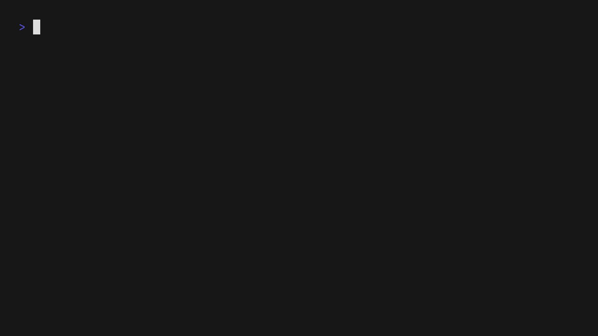

# ColdCase: Integrated Digital Forensics Tool

[](https://golang.org/)
[](https://creativecommons.org/publicdomain/zero/1.0/)
[](https://github.com/Fakechippies/ColdCase)
[](https://www.docker.com/)
[](#features)

[](https://github.com/Fakechippies/ColdCase/actions/workflows/ci.yml)
[](https://github.com/Fakechippies/ColdCase/actions/workflows/codeql.yml)
[](https://github.com/Fakechippies/ColdCase/releases)
[](https://github.com/Fakechippies/ColdCase/pkgs/container/coldcase)

A comprehensive CLI tool that integrates 118+ digital forensics utilities into a single, unified interface — plus a **local-only web console** for browsing the catalog, running tools with evidence uploads and reviewing signed sessions from the browser. ColdCase implements a **Hybrid Execution Model**: it runs tools natively if available, but transparently falls back to a Docker container if not, with automatic path mapping.

## Showcase



## Key Features

- **Hybrid Proxy Runtime**: Native speed when possible, container reliability when needed.
- **Smart Path Mapping**: Host paths in arguments are automatically detected and mounted to the container.
- **Extended Toolset**: 118+ tools across 14 categories.
- **Local Web Console**: Server-rendered dashboard, tool catalog, availability graphs and a live output runner at `http://127.0.0.1:8765`.
- **Forensic Session Management**: Automated audit logging with Ed25519 cryptographic signing.
- **Advanced State Control**: Unlocked, Locked, and SEALED states for rigid chain of custody.
- **Integrated Key Management**: Built-in Ed25519 keypair generation and management.
- **Plaso Integration**: Structured `plaso` command group for timeline analysis.
- **Container Management**: Built-in commands to build, pull, and shell into the forensics environment.

## Tool Categories

### [DidierStevens Suite](https://blog.didierstevens.com/programs/pdf-tools/) (15 tools)
`1768`, `pdf-parser`, `pdfid`, `oledump`, `pecheck`, `base64dump`, `emldump`, `jpegdump`, `hash`, `cut-bytes`, `find-file-in-file`, `byte-stats`, `extractscripts`, `cs-parse-traffic`, `amsiscan`

### [Volatility3](https://github.com/volatilityfoundation/volatility3) Memory Forensics (31 plugins)
- **Windows**: `pslist`, `pstree`, `dlllist`, `handles`, `cmdline`, `envars`, `filescan`, `modules`, `driverscan`, `callbacks`, `services`, `registry`, `hashdump`, `malfind`, `mutantscan`, `ssdt`, `getsids`, `privs`, `vadinfo`, `dumpfiles`, `mftscan`
- **Linux**: `pslist`, `pstree`, `bash`, `proc_maps`, `mount_info`
- **macOS**: `pslist`, `pstree`, `mount_info`
- **Utility**: `vol`, `volshell`, `info`

### Network Forensics (11 tools)
`tshark`, `tcpdump`, `zeek`, `ngrep`, `tcpflow`, `pcapfix`, `tcpreplay`, `tcpstat`, `argus`, `p0f`, `networkminer`

### File Carving & Recovery (7 tools)
`foremost`, `scalpel`, `photorec`, `bulk-extractor`, `testdisk`, `ddrescue`, `safecopy`

### Timeline & Log Analysis (5 tools + Plaso)
- **Commands**: `hayabusa`, `evtx_dump`, `timeliner`, `chainsaw`
- **Plaso Group**: `plaso parse`, `plaso sort`, `plaso psteal`, `plaso parsers`

### Malware & Pattern Matching (5 tools)
`yara`, `floss`, `strings`, `capa`, `vt` (VirusTotal CLI)

### Windows Artifacts (7 tools)
`regripper`, `regrippy`, `analyzeMFT`, `ntfsls`, `ntfscat`, `indxparse`, `registry-dump`

### Steganography & Media (5 tools)
`steghide`, `zsteg`, `wavsteg`, `mediainfo`, `stegdetect`

### Hashing & Verification (4 tools)
`md5deep`, `hashdeep`, `ssdeep`, `tlsh`

### Mobile Forensics (4 tools)
`aleapp`, `ileapp`, `adb`, `ideviceinfo`

### System Utilities (6 tools)
`xxd`, `objdump`, `readelf`, `nm`, `file`, `ldd`

### Sleuth Kit (5 tools)
`fls`, `fsstat`, `istat`, `jls`, `tsk_loaddb`

## Installation

### Prerequisites
- [Go 1.25+](https://golang.org/)
- (Optional) Docker for the hybrid container runtime.

### Automatic Setup
```bash
# Clone the repository
git clone https://github.com/Fakechippies/ColdCase
cd ColdCase

# Install the CLI onto your PATH
go install ./cmd/coldcase

# Option A: Install tools on the host
coldcase install

# Option B: Set up the hybrid container (recommended)
coldcase install --container
```

### Signed releases

Prebuilt binaries for linux/darwin/windows (amd64 + arm64) are published on
the [Releases page](https://github.com/Fakechippies/ColdCase/releases).
`checksums.txt` is signed with Ed25519; verify before use:

```bash
coldcase-sign verify -pub "$(cat keys/release_public.key)" \
    checksums.txt checksums.txt.sig
sha256sum --check checksums.txt
```

See [docs/RELEASING.md](docs/RELEASING.md) for the full process.

## Usage

### Basic Commands
```bash
coldcase list             # Show all 118+ tools
coldcase check            # Check tool status (native/container)
coldcase container status  # Check Docker status
coldcase --help           # Grouped help: ColdCase commands + Forensics tools
```

## Web Console

ColdCase ships with a local-only web UI. Every action in the browser flows
through the same runner, session logging and catalog whitelist as the CLI.

### Starting the server

```bash
# Install once (or: go build -o coldcase ./cmd/coldcase for a local binary)
go install ./cmd/coldcase

# Start the web console as a detached background process
coldcase serve

# Custom port / host
coldcase serve --port 9000
coldcase serve --host localhost --port 9000

# Explicit start (same as bare 'serve')
coldcase serve up
```

`serve` daemonizes: it returns immediately and prints the URL, PID and log
location. The console is available at **http://127.0.0.1:8765** by default,
with output captured to `~/.coldcase/serve.log`.

To run in the foreground instead (Ctrl+C to stop):

```bash
coldcase serve run
```

> **Security:** the console binds to 127.0.0.1 only. It refuses to bind to a
> non-loopback address unless you pass `--allow-remote` (and confirm
> interactively, or skip the prompt with `--yes`). Exposing the console beyond
> loopback lets anyone with network access execute tools — avoid it unless you
> understand the risk.

### Checking and stopping the server

```bash
coldcase serve status   # running? which address, which pid
coldcase serve down     # graceful stop (SIGTERM, with SIGKILL fallback)
```

`serve down` only stops processes it can verify belong to ColdCase, and it
cleans up a stale `~/.coldcase/serve.pid` automatically. There is no daemon or
system service; once stopped, nothing is listening.

### Console tabs

| Tab | What it does |
|-----|--------------|
| **Dashboard** | Read-only telemetry: availability donut, session states, 7-day command activity, top tools, category coverage. No actions live here. |
| **Run Tool** | Pick any catalog tool, attach an evidence file, choose a session and stream stdout/stderr live. |
| **Tool Catalog** | Searchable, icon-driven catalog grouped by category, with per-tool availability badges. |
| **Availability** | Coverage graphs (native vs container vs missing) plus a filterable table of every tool. |
| **Sessions** | Create sessions, review the signed audit trail, verify signatures, export reports. |

### Running a tool from the browser

1. Open the **Run Tool** tab (or click a tool in the **Tool Catalog**).
2. **Attach evidence**: drop or browse for a file. It is uploaded to
   `~/.coldcase/uploads`, hashed and recorded in the session's evidence log.
   Uploads are optional — flag-only runs work too.
3. **Extra arguments**: one per line. Use `{file}` where the upload path should
   appear; if omitted, the upload path is appended automatically.
4. **Session**: select an unlocked session to log and sign the execution, or
   leave it empty for a quick, unlogged run.
5. Click **Run tool**. Output streams live; **Stop** aborts the process.

Tools that may need elevated privileges ask for an explicit per-run
confirmation checkbox before they will execute.

### Housekeeping

- Uploaded evidence stays under `~/.coldcase/uploads` so session hashes keep
  resolving; delete files you no longer need manually.
- Sessions live under `~/.coldcase/sessions`; the console can lock, seal and
  export them like the CLI.
- If no signing keys exist yet, the **Sessions** tab offers a one-click
  **Generate signing keys** action (equivalent to `coldcase keys generate`).

### Hybrid Engine Examples
If `tshark` is not on your host, ColdCase runs it via the container automatically:
```bash
# Path /evidence/dump.pcap is auto-detected and mounted to the container
coldcase tshark -r /evidence/dump.pcap -Y "http"
```

### Plaso Timeline Analysis
```bash
coldcase plaso parse disk.img      # log2timeline
coldcase plaso sort storage.plaso  # psort
coldcase plaso parsers --list      # list available parsers
```

### Forensic Session Management

ColdCase provides a forensically sound environment by logging every action.

```bash
# 1. Setup investigator keys
coldcase keys generate

# 2. Start a signed forensic session
eval $(coldcase session start case-001 --sign)

# 3. Run any tool - execution & hashes are logged automatically
coldcase pdfid malware.pdf

# 4. Verify cryptographic integrity
coldcase session verify case-001

# 5. Lock or PERMANENTLY SEAL the session
coldcase session lock case-001
coldcase session seal case-001

# 6. Export the investigation report
coldcase session export case-001 --format html > report.html
```

### Container Management
```bash
coldcase container build  # Build the forensics image locally
coldcase container shell  # Open a bash shell inside the container
```

## Architecture

ColdCase uses a **Modular Proxy Pattern** written in Go:
- **`pkg/runner`**: The core execution engine. It checks for native binary existence, and if missing, executes the command via `docker run`.
- **Argument Remapping**: The runner scans arguments for host filesystem paths, generates bind-mount flags (`-v`), and remaps the argument paths to match the container environment.
- **`Dockerfile`**: A multi-stage build providing a pre-configured forensics environment with all 118+ utilities.

## Contributing & Process

ColdCase is developed with an agile process:

- [CONTRIBUTING.md](CONTRIBUTING.md) — branch naming, conventional commits, PR flow
- [docs/DEFINITION_OF_DONE.md](docs/DEFINITION_OF_DONE.md) — the quality bar
- [CHANGELOG.md](CHANGELOG.md) — release history
- Sprint work is tracked on the
  [project board](https://github.com/users/Fakechippies/projects) and through
  user-story issues; retrospectives live in `docs/retrospectives/`.

## License

[](https://creativecommons.org/publicdomain/zero/1.0/)

---

This project integrates various open-source forensics tools. Please check individual tool licenses for specific requirements.
